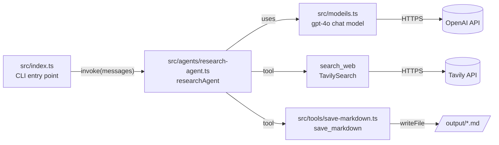
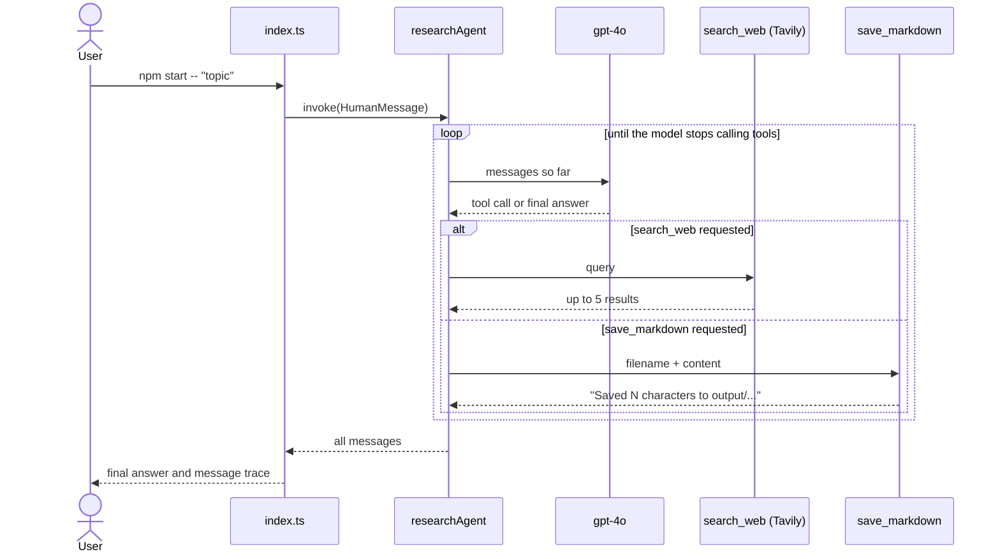

# single-agent

A small research agent built with [LangChain](https://js.langchain.com/). Give it a topic and it searches the web, then saves its findings as a markdown file in `output/`.

## Installation

**Prerequisites**

- Node.js 20 or newer (the code uses top-level `await` and ES modules)
- An [OpenAI API key](https://platform.openai.com/api-keys)
- A [Tavily API key](https://app.tavily.com/) (web search)

**Steps**

```bash
# 1. Install dependencies
npm install

# 2. Create a .env file in the project root
cat > .env <<'EOF'
OPENAI_API_KEY=your-openai-key
TAVILY_API_KEY=your-tavily-key
EOF
```

`.env` is listed in `.gitignore`, so your keys won't be committed.

## Running

```bash
# Research the default topic ("The rise of edge computing")
npm start

# Research your own topic
npm start -- "Quantum error correction"
```

The script prints the agent's final answer, followed by a short trace of every message in the run (human, AI, and tool messages, truncated to 120 characters each). The saved brief appears in `output/`.

## Architecture

### Components



| File | Responsibility |
| --- | --- |
| `src/index.ts` | Reads the topic from `argv`, invokes the agent, prints the result and message trace. |
| `src/agents/research-agent.ts` | Builds the agent with `createAgent`, wiring together the model, the tools, and the system prompt. |
| `src/modeils.ts` | Loads `.env` and initialises the `gpt-4o` chat model (temperature 0.3, 60 s timeout). |
| `src/tools/save-markdown.ts` | Custom tool that writes markdown to `output/<filename>`, creating the folder if needed. Inputs are validated with Zod. |

### What happens during a run

The agent follows a tool-calling loop: the model decides whether to call a tool or answer, and LangChain feeds tool results back to it until it produces a final reply.



### Configuration

- **Model:** change the model name or its options in `src/modeils.ts`.
- **Search depth:** `maxResults` is set where `TavilySearch` is created in `src/agents/research-agent.ts` (currently 5).
- **Prompt:** `research-agent.ts` defines a detailed `RESEARCH_PROMPT` (a fixed brief format saved as `research.md`), but the agent is currently created with the shorter `badPromt`. Swap the `systemPrompt` value to use the detailed one.

## Development

TypeScript runs directly through [`tsx`](https://tsx.is/), so there is no build step. The `tsconfig.json` uses `moduleResolution: "Bundler"`, which means imports are written without file extensions.

```bash
npx tsc --noEmit     # type-check
npx prettier --write . # format
```

Prettier is configured in `.prettierrc`, and the Zed settings in `.zed/settings.json` format files on save.
